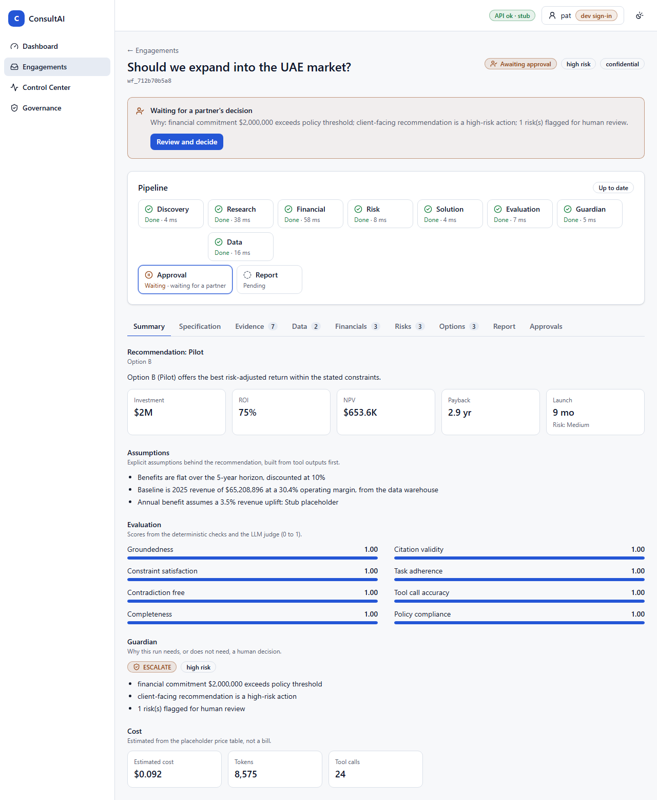
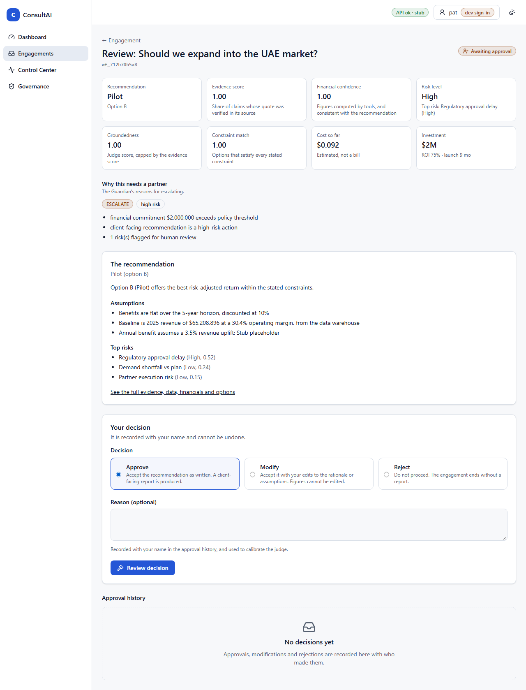
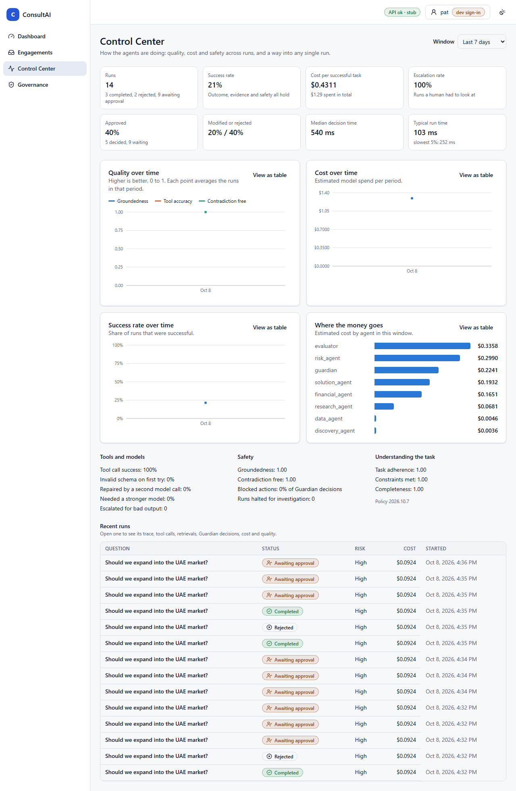
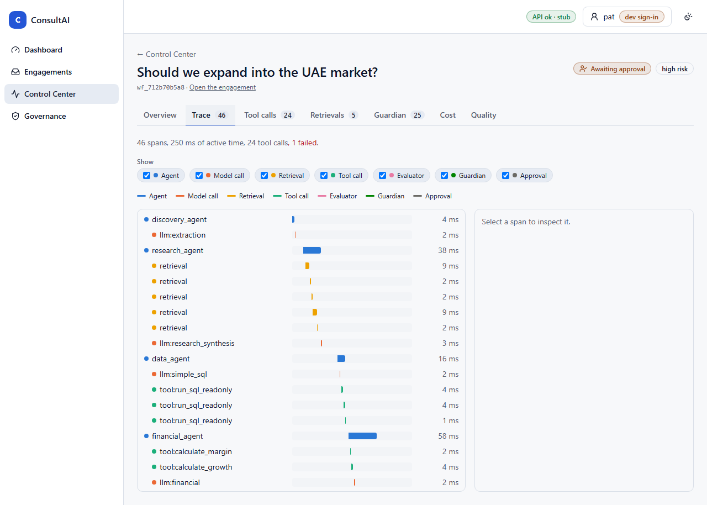
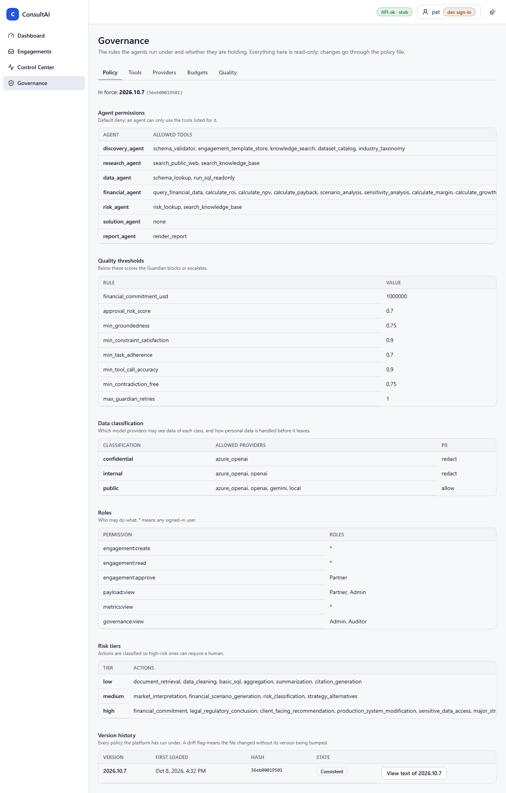

# ConsultAI: a governed multi-agent consulting platform

Agents do the work. The control plane decides what they are allowed to do.

ConsultAI breaks a business question into specialised agent tasks (Discovery, Research, Data, Financial, Risk,
Solution), scores the output, runs it through a Guardian, and requires a human partner to approve anything
high-risk. Policy, model routing, budgets, tracing and audit sit underneath all of it.



## Try it in one command

Needs Python 3.12+ and Node 22+. Nothing leaves your machine: it uses the offline stub models.

```bash
pip install -e "backend/.[dev]"
cd frontend && npm install && cd ..
python backend/scripts/demo.py
```

Open <http://localhost:5173>, choose an identity from the header, and:

1. **Partner**: open an engagement waiting for approval, read the Guardian's reasons and the evidence, then
   approve, modify or reject. Or submit **"Should we expand into the UAE?"** and watch the pipeline run live.
2. **Anyone**: open the **Control Center** for quality, cost and safety across runs; open a run for its trace,
   tool calls, retrievals, Guardian decisions, cost and scores.
3. **Admin or Auditor**: open **Governance** for the policy in force and its history, the tool registry,
   provider health, budgets and the quality-degradation level.

The demo seeds five engagements (approved, rejected, modified, and two waiting for a partner) into a fresh
database each time. The API runs on port 8010, so it will not clash with something already on 8000.

| | |
|---|---|
|  |  |
|  |  |

## What makes it governed

1. **The model chooses; code calculates.** Every number comes from a schema-validated tool, never model text ([ADR 0001](docs/adr/0001-llm-chooses-code-calculates.md)).
2. **Deterministic Guardian first, AI Guardian second, human third.** The AI layer can only tighten a decision ([ADR 0002](docs/adr/0002-guardian-layers-and-human-approval.md)).
3. **Least privilege.** Default-deny tool permissions per agent, role-based API access, each agent sees only its slice of state.
4. **Bounded.** Token, cost, time and tool-call budgets per run; tool timeouts; concurrency limits with a queue and a 429 when full.
5. **Resilient without leaking.** Circuit breakers and provider failover, restricted by the data's classification; PII redacted before it leaves ([ADR 0005](docs/adr/0005-provider-failover-by-data-classification.md)).
6. **Auditable.** Every decision is stamped with the policy version; approvals, tool calls and retrievals are recorded and replayable.

## Anti-reward-hacking: what "success" means here

A run is **successful only if all three hold**:

| Leg | Question | How it is checked |
|---|---|---|
| **Outcome** | Does it answer the question within the stated constraints? | Constraint satisfaction, completeness and task adherence; options that break a constraint are not counted as satisfying it |
| **Evidence** | Is each claim backed by a source that really says it? | Each cited quote is searched for in the source text (citation validity); groundedness from the LLM judge is **capped by** it |
| **Safety** | Did it stay inside policy? | No blocked tool calls, no policy breach, high-risk steps reviewed by a human; contradiction and tool-call accuracy are computed without a model |

Why: if "success" meant "the task finished" or "the judge liked it", the cheapest way to score well is to
sound confident, cite loosely and skip checks. Each leg can be checked independently of the model that
produced the work, so there is no single score to game. The headline metric, *cost per successful task*,
uses this definition, so a cheap run that fails a leg does not look efficient. If scores drop over a window,
the platform becomes cautious (stronger models, wider retrieval), then requires partner review of every run,
and recovers only after scores clear the limit by a margin so it does not flap. Details: [ADR 0004](docs/adr/0004-success-is-outcome-evidence-safety.md).

## Repository layout

```
backend/app/
  api/            FastAPI routes: engagements, approvals, control center, governance, metrics
  agents/         The six agents and the report agent
  control_plane/  policy, guardian (rules + LLM), evaluator and judge, model gateway and router, budgets,
                  circuit breakers, rate limits, run scheduler, tool registry and timeouts, degradation
  workflow/       LangGraph state machine with an interrupt for approval; the engagement service
  tools/          Deterministic tools (financial maths, SQL validation, retrieval)
  security/       Auth (dev headers or Entra JWT), RBAC, PII redaction, Key Vault secret references
  observability/  OpenTelemetry tracing, run metrics, MLflow export
  persistence/    SQLAlchemy Core (SQLite in dev, Postgres in production)
  schemas/        Pydantic models and the engagement state
frontend/         React + TypeScript + Vite app (see frontend/README.md)
policies/         policy.yaml: versioned, declarative rules
infra/            Dockerfiles, compose
docs/             Implementation plan, ADRs, status, screenshots
```

## Develop

```bash
# backend
cd backend && pip install -e ".[dev]" && pytest && ruff check app tests
uvicorn app.main:app --reload --port 8010

# frontend
cd frontend && npm install
npm run dev            # http://localhost:5173  (set VITE_API_BASE_URL if the API is not on :8000)
npm test               # unit + accessibility (axe), mocked API
npm run e2e            # Playwright: the whole journey in a browser against the real API
npm run lint && npm run typecheck && npm run build
npm run api:update     # regenerate the typed client after changing an endpoint
```

By default the platform runs offline (`LLM_PROVIDER=stub`) so every path (workflow, Guardian, approval,
tracing) works without credentials. Set `LLM_PROVIDER=azure_openai` and the Azure variables in `.env` to use real models; see `.env.example`.

## API

Interactive docs at `/docs` when the API runs. Main groups:

| Group | Endpoints |
|---|---|
| Engagements | `POST /engagements` (429 with Retry-After when the queue is full), `GET /engagements`, `GET /engagements/{id}`, `/events` (SSE), `/evidence`, `/tables`, `/guardian`, `/cost`, `/approvals` |
| Approval | `POST /engagements/{id}/approval` with `approve`, `modify` or `reject` (Partner role) |
| Control Center | `GET /control-center/{id}/trace`, `/metrics/summary`, `/metrics/timeseries`, retrieval replay |
| Governance | `GET /governance/policy`, `/policy/versions[/{key}]`, `/tools`, `/providers`, `/budgets`, `/degradation` (Admin or Auditor) |
| Session | `GET /me` (identity, roles, permissions), `GET /health` |

## Status

See [docs/STATUS.md](docs/STATUS.md) for what is built and tested, and what still needs real cloud services
(Azure AI Search, ADLS, Databricks, Cosmos DB) and a formal measurement run. The build plan is in
[docs/IMPLEMENTATION_PLAN.md](docs/IMPLEMENTATION_PLAN.md); design decisions are in [docs/adr](docs/adr/README.md).
